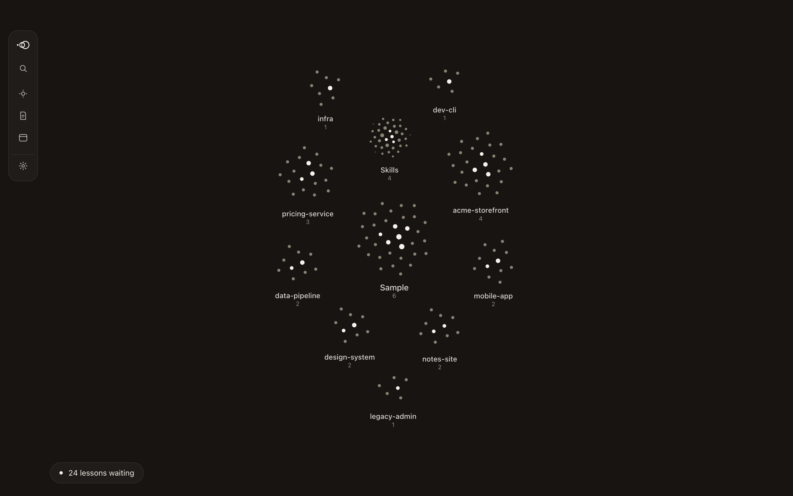
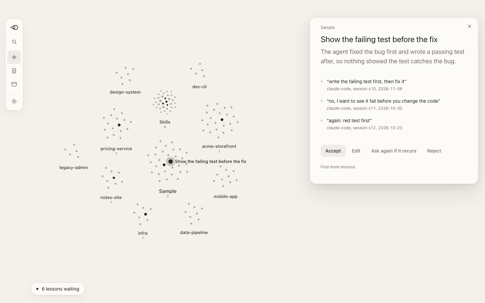
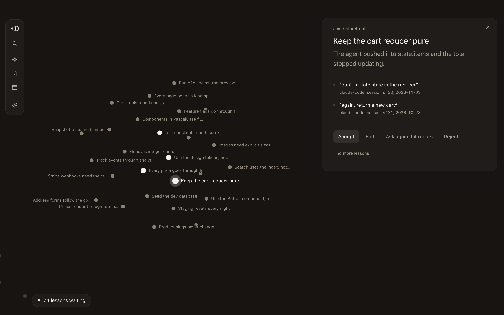
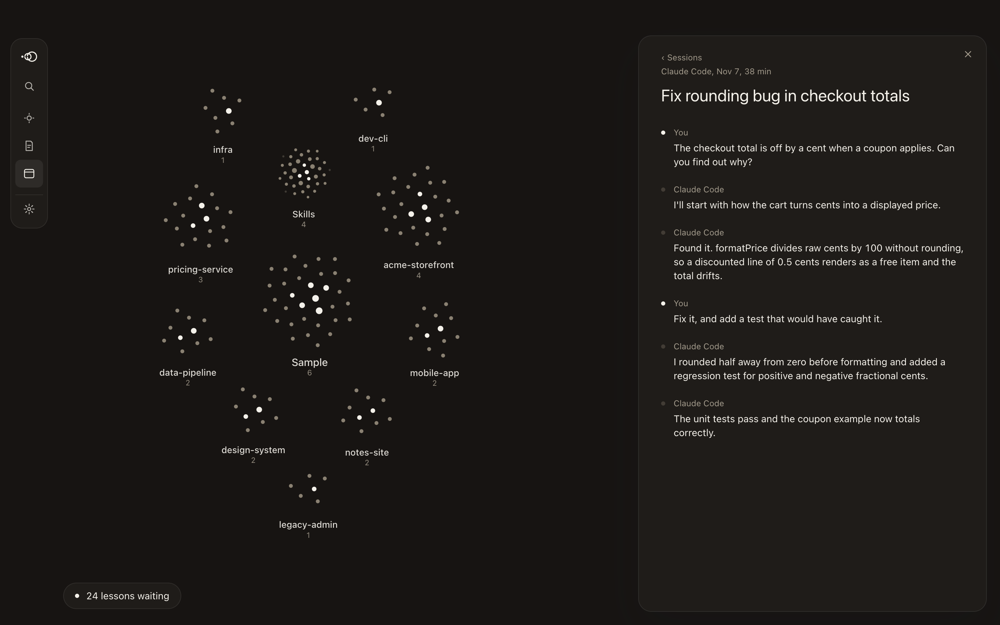
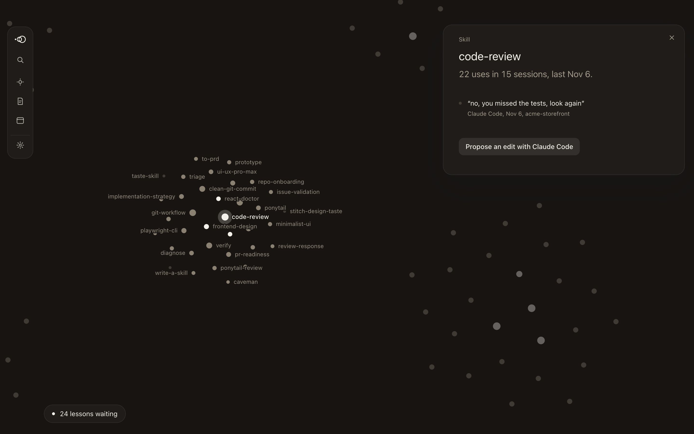

<p align="center">
  <picture>
    <source media="(prefers-color-scheme: dark)" srcset="assets/brand/lore-mark-light.svg">
    
  </picture>
</p>

<h1 align="center">Lore</h1>

<p align="center">
  Long-term memory for your coding agents, built from the corrections you already gave them.
</p>

<p align="center">
  <a href="https://github.com/hsusul/lore/releases/latest">Download</a> ·
  <a href="#get-started">Get started</a> ·
  <a href="#the-archive">Archive</a> ·
  <a href="#memory">Memory</a> ·
  <a href="#skills">Skills</a> ·
  <a href="#using-lore-from-an-agent">Agents</a> ·
  <a href="#privacy">Privacy</a>
</p>

<p align="center">
  
</p>

Lore keeps a local, searchable archive of your Claude Code and Codex sessions.
It finds the times you corrected an agent ("no, use pnpm not npm"), turns them into lessons, and, once you accept one, shows it to every connected agent from the next session on.
It also checks the skill folders your agents load for duplicates, drift, and broken references.

Three rules hold the design together.

- The vault is the truth. The index, the archive, and anything an agent sees are derived and rebuildable.
- Agents only propose. A person accepts. Agents never get delete.
- Every recalled note says whether the code it points at still matches. A stale note is labelled, not silently served.

## A look around

The desktop app opens on a map of everything Lore knows. Your global notes sit in the middle, each repository gets its own cluster, and your skills have one more.

**Review a lesson.** Each lesson comes with its receipts: what you said, in which session, and when. Accept it, edit the wording, or reject it.



**Zoom into a repository.** Click a cluster to read its notes. The Lore logo takes you back out to the whole map.



**Read a session.** Search or browse every session without leaving the map.



**See which skills need a look.** A skill you had to re-prompt after shows the moment it went wrong, and an agent can draft the fix for you to apply.



The screenshots use the sample data that `npm run dev` serves. None of it is real.

## Get started

Lore is early. The [latest release](https://github.com/hsusul/lore/releases/latest) has `lorectl` for macOS on Apple Silicon (`aarch64-apple-darwin`) and Intel (`x86_64-apple-darwin`), and for Linux (`x86_64-unknown-linux-gnu`). Download the archive for your machine, check it against `SHA256SUMS` (`sha256sum -c` on Linux), and put `lorectl` on your `PATH`, where agents can run it too:

```bash
version=v0.2.3
target=aarch64-apple-darwin
base=https://github.com/hsusul/lore/releases/download/$version
curl -LO "$base/lorectl-$version-$target.tar.gz" -LO "$base/SHA256SUMS"
shasum -a 256 -c SHA256SUMS --ignore-missing
tar -xzf "lorectl-$version-$target.tar.gz"
mkdir -p ~/.local/bin && cp "lorectl-$version-$target/lorectl" ~/.local/bin/  # must be on PATH
lorectl init
```

The builds are not signed. macOS refuses to run a file a browser downloaded until you clear its quarantine flag with `xattr -d com.apple.quarantine lorectl`. `curl` sets no such flag.

To build from source instead, you need Rust and git. `rust-toolchain.toml` pins the toolchain, and rustup selects it. Run `cargo build --release -p lorectl` and put `target/release` on your `PATH`.

`lorectl init` makes the vault at `~/Lore`, scans the sessions of the last 30 days for up to a minute, newest first, and shows the lessons it found in your corrections. `--since`, `--scan-seconds`, and `--limit` change those numbers. Whatever it did not reach waits for the next `lorectl init` or `lorectl scan --since 30d`. It reads your Claude Code and Codex logs and never changes them.

Then, in Claude Code, install the plugin and let the agent write your lessons:

```text
/plugin marketplace add hsusul/lore
/plugin install lore@lore
/lore:lore-lessons
```

The agent reads every candidate Lore mined, groups the ones that mean the same thing, and files each rule with its receipts, the sessions it came from. Nothing becomes a note until you accept it:

```bash
lorectl init --review
```

It offers each proposal to accept, reject, or skip, then each lesson it mined itself to accept, edit, or skip. `--no-review` only lists them. From the next session on, the plugin's hooks show the accepted notes to the agent, each with a freshness label: at session start, next to a prompt they match, and before an edit to a file they are anchored to. [Plugins](#plugins) says what each hook does.

Without the plugin, or for Codex, run `lorectl connect`. It says whether each agent runs the MCP server and the three hooks, and prints the exact command or config to add for each one missing. A piece an enabled plugin runs reads as `connected (plugin <name>)`, with nothing to add. Codex runs a hook only after you approve it, so a Codex hook that is configured but not yet approved reads as `configured but not approved (Codex skips it)`; approve it by starting `codex` and choosing "Trust all and continue" (or "Review hooks") at the "Hooks need review" prompt, or with `/hooks` in a running session. It reads the agents' config files and writes none. `lorectl help mem` prints the memory commands alone.

### The desktop app

The desktop app is a second front end over the same archive. The release has it as `Lore_<version>_aarch64.dmg`, for Apple Silicon only, and `SHA256SUMS` does not list it. It is not signed: drag Lore to Applications, then right-click it and choose Open the first time, or run `xattr -dr com.apple.quarantine /Applications/Lore.app`. To run it from source you need Node.js 20, the Xcode command-line tools, and the Tauri 2 prerequisites for macOS. Then run `npm run tauri dev`.

## The archive

`lorectl scan` reads the session logs Claude Code and Codex already keep on disk. It looks in `~/.claude/projects`, `~/.codex/sessions`, and `~/.codex/archived_sessions`. `CLAUDE_CONFIG_DIR` and `CODEX_HOME` move those roots. Lore opens them read only and never changes them. A second scan of unchanged files ingests nothing. Every scan ingests the newest files first.

A large history takes a while to scan the first time. `lorectl scan --since 30d` ingests only the files modified in the last 30 days (`h` for hours and `m` for minutes work too), so you can start with recent work and run a full `lorectl scan` later. A `--since` scan never marks older files missing.

The archive is a SQLite database named `lore.db` with `blobs` beside it. It lives in the platform data directory under `dev.lore.app`. `LORE_ARCHIVE_DIR` or `--archive <DIR>` moves it. The path must be absolute.

A newer build upgrades an older archive on its first scan, and commands that only read refuse it until then (exit 4). Before an upgrade that older builds cannot read back, it backs the archive up into `backups/` beside it. Backups are integrity-checked, then stored zstd-compressed as `lore-<time>-<n>.db.zst` (about 2.2x smaller); plain `.db` backups from earlier builds still restore and age out under the same retention (newest 7 by default). Taking a backup needs free space for one uncompressed copy of the archive plus the compressed file. Lore stores each attachment body and tool output once, and stores message bodies zstd-compressed. New sessions are stored that way. Sessions an older build stored are converted after a scan that finished, by `lorectl scan` (after a backup; `--no-compact` skips it) and by the desktop app in the background. `lorectl init` does not convert them.

```bash
lorectl scan
lorectl search "retry agent:codex"
lorectl inspect <SESSION_ID> --patch
lorectl status
lorectl report
```

The query is one argument, so quote it. Plain words are searched as text. Filters narrow the search.

| Filter | Matches |
| --- | --- |
| `agent:codex` | Sessions from one agent (`claude-code` or `codex`) |
| `path:src/auth/` | Sessions that touched a file under this path |
| `tool:Bash`, `model:sonnet` | Sessions that called this tool, or ran on a matching model |
| `repo:lore`, `branch:main`, `commit:1a2b3c` | A repository, a git branch, or a commit sha prefix |
| `after:2026-07-01`, `before:2026-08-01` | Sessions started on or after, or before, a date |
| `has:error`, `has:patch` | A tool call failed, or the session recorded a patch |

Lore links each session to the git repository it worked in. It records which branch and commit the session saw. For files an agent wrote, it checks whether that exact content reached a commit. `lorectl status` flags agent-written files that are staged and not committed. `lorectl hook session-start` prints the same warning for an agent at the start of a session, and prints nothing when there is nothing at risk.

`lorectl --help` lists every command, option, and exit code.

## Memory

Memory lives in a vault. The vault is a git repository of markdown notes that Obsidian can open. It is at `~/Lore` unless `LORE_VAULT_DIR` or `--vault <DIR>` says otherwise. Every write is one git commit.

```bash
lorectl mem init
```

### Add a note

A note is a markdown file with frontmatter. The `type` is one of `convention`, `decision`, `fact`, `howto`, or `pitfall`. Lore fills in `id`, `created`, `status`, and `scope` when you leave them out. A note with no scope is global.

```bash
cat > note.md <<'EOF'
---
type: convention
title: Quote every query argument
---
lorectl takes the query as one argument, so quote it.
EOF
lorectl mem add note.md
```

`-` reads the note from stdin. Global notes land in `global/`. A note for one repository has `scope: repo:<key>` and lands in `repos/<name>-<key>/`. The key is a hash of the repository's `origin` URL. `lorectl mem recall --json` prints it for the repository you are in. Anchors tie a note to lines of code. Pass `--cwd <DIR>` so Lore pins each anchor's hash and commit from that repository.

```markdown
---
type: pitfall
title: Line 3 is load bearing
scope: repo:83ce96d0c231c106
anchors:
  - path: src/lib.rs
    lines: 3
---
Do not reorder line 3.
```

### Recall

```bash
lorectl mem recall                 # global notes and notes for this repository
lorectl mem recall "worktree"      # only notes that match the words
lorectl mem recall --cwd ~/code/app --limit 5 --json
lorectl mem search "index lock"    # BM25 ranking over every note
lorectl mem show <NOTE>            # by id, file name, or vault path
```

Each recalled note carries a freshness label.

| Label | Meaning |
| --- | --- |
| `fresh` | The anchored lines are where the note says. |
| `moved` | The lines are unchanged but now somewhere else. Lore prints the new place. |
| `changed` | The file is there but the anchored lines are not. |
| `gone` | The file is gone and no rename of it was found. |
| `unanchored` | The note has no anchors, so there is nothing to check. |

You can edit, rename, or delete notes by hand, in an editor or in Obsidian. Search and show pick up the change. `lorectl mem reindex` rebuilds the index from the vault files alone. It also names any two active notes with near-identical titles, since session start shows only one of them; retire the other.

### The inbox and review

Agents do not write notes. They file proposals into the vault's `_inbox/`, which git ignores. Lore redacts secrets in a proposal's title, body, and anchor paths before it is stored. A person reviews the inbox.

```bash
lorectl mem inbox                          # pending proposals
lorectl mem accept <ID>                    # write it as a note, one commit
lorectl mem accept <ID> --as <slug>        # with a file name you choose
lorectl mem reject <ID> --reason "<TEXT>"  # decline; the vault is untouched
lorectl mem retire <NOTE> --reason "<TEXT>"
```

Under each proposal, `mem inbox` prints its receipt: the archived session it came from, that session's date, and a short redacted excerpt of the passage that shares the most words with the proposal. With no archive, or a session the archive does not hold, it says so in one line. `--json` carries the same as `receipt`.

`mem inbox` marks each proposal's source `(verified)` when the archive held that agent's session at the time the proposal was filed, and `(unverified)` otherwise. Proposals filed with `mem propose`, or before Lore recorded this, are unverified.

`lorectl mem mine` reads the archive for corrections you made to an agent, such as "no, use pnpm not npm", standing rules such as "make sure the docs are never pushed", and instructions you had to repeat. It groups the ones that say the same thing into lessons and keeps those that state a rule. Lessons rank first by how much they read like a standing rule: "from now on", "always", "never", and "make sure" raise one ("make sure" less when the same turn also says to push, merge, or the like), and a PR or issue number, a branch name, a URL, a masked secret, a one-off order like "push this branch", or a chore with a rule tacked on with "and" ("delete the runtimes and build them on my ssd from now on") lowers it. Then lessons you gave in more conversations rank higher, then newer ones. A resumed or forked copy of a conversation counts once. Each lesson prints with its receipts: the sessions it came from, the date, what you said, and what the agent had just done. Under a lesson, `may conflict with` lists up to three later turns in the same repository about the same command (PR, push, commit, branch, merge, rebase, tests, mocks, docs, permission). Lore does not judge them: read them, or let the agent judge them through `mine_candidates`, before you accept the lesson. A lesson that scores below zero reads as a one-off order and is left out; the first line counts them, and `--all` lists them too. It is a dry run: it writes nothing. `--limit N` (default 20) and `--json` are optional. Two limits tune what it finds: `--min-overlap PERCENT` (default 50) is how much of their words two corrections must share to be one lesson, and `--max-chars N` (default 300) is the longest turn still read as a correction. Pass the same limits with `--propose`, since they decide which lessons exist.

`--new` keeps only lessons with a correction no Find lessons run has read yet. `--replies` also lists ordinary replies from the last 48 hours that no rule flagged. A bare go-ahead such as "yes, merge them" is left out. `--reply-days N` looks back N days instead and implies `--replies`. In `--json`, each receipt carries the agent text before the turn as `before` and the agent's answer as `after`.

`lorectl mem mine --propose <ID>...` files the lessons you name into the inbox, each with its receipts in the body, for you to accept or reject like any proposal. It never files the same lesson twice. To file a reply listed with `--reply-days`, pass the same `--reply-days`.

`lorectl mem eval` scores a policy for accepting proposals without you against the proposals you already accepted and rejected. It reports how many it would have taken off your hands, lists every one it would have accepted that you rejected, and says whether it clears a fixed bar. It accepts nothing and writes nothing. `--policy` is `never` (the default) or `starting-bar`.

A script or an agent without MCP can file a proposal with `lorectl mem propose`. The body is read from stdin.

```bash
echo "Run cargo with CARGO_BUILD_JOBS=4 on this host." | \
  lorectl mem propose --agent claude-code --session <SESSION> --type pitfall --title "Bound cargo jobs"
```

`--scope`, `--anchor PATH[:LINES]`, and one of `--updates`, `--extends`, or `--derives <ID>` are optional.

### Report

`lorectl report` answers the question Lore exists for, over a window. It shows the corrections you gave agents, how many became lessons, whether the lessons were shown to agents, and how many mistakes you corrected again after a note about them was accepted. It has five sections, and each count names its source:

- Activity: sessions and user turns by agent, and the top repositories, from the archive.
- Corrections: what `lorectl mem mine` finds in the window, rule-flagged and reply candidates, and how many a finished Find lessons run already read.
- Lessons: proposals filed, accepted, and rejected in the window, proposals pending now, and active notes.
- Delivery: sessions a hook showed a note to, and the notes shown most. The hooks keep these records for 7 days.
- Repeats: corrections that share at least two content words with an active note accepted before them. It is an estimate from word overlap.

```bash
lorectl report                 # the last 7 days, every repository
lorectl report --since 30d     # or 12h, 90m, or a start date like 2026-11-01
lorectl report --cwd . --json  # one repository, as JSON
```

With `--cwd`, activity, corrections, and repeats cover that repository only. Lessons and delivery stay vault-wide.

It reads the archive and the vault and writes to neither. With no archive or no vault yet, it says so and exits 0.

## Skills

`lorectl skills` reports on the skill folders your agents load. It reads `~/.agents/skills`, `~/.claude/skills`, `~/.codex/skills`, `~/.cursor/skills`, and plugin caches. It never writes.

```bash
lorectl skills ls       # every skill, with where it is installed and its source
lorectl skills doctor   # problems, each with a command to fix it or a hint
```

`skills doctor` reports duplicates, drift between copies, unknown sources, broken references, name mismatches, bad frontmatter, and Codex's skill budget. It exits 0 whenever the scan ran. Add `--json` to gate a script on the findings. `HOME`, `CLAUDE_CONFIG_DIR`, and `CODEX_HOME` set where it looks.

## Using Lore from an agent

`lorectl mcp` is a Model Context Protocol server on stdin and stdout. An agent runs it. Give the agent the absolute path to the binary. Run `lorectl scan` first, or the session tools report that there is no archive yet.

Claude Code:

```bash
claude mcp add --scope user lore -- /absolute/path/to/lorectl mcp
```

Without `--scope user`, Claude Code adds the server to the current project only.

Codex, in `~/.codex/config.toml`:

```toml
[mcp_servers.lore]
command = "/absolute/path/to/lorectl"
args = ["mcp"]
```

The vault is `~/Lore` by default. For another vault, set `LORE_VAULT_DIR` to an absolute path in the server's environment. For another archive, add `--archive /absolute/dir` to the arguments. Lore names the agent behind a proposal from `LORE_AGENT` in the server's environment, else from the name the client sends. If proposals fail with `agent_unknown`, set `LORE_AGENT=claude-code` or `LORE_AGENT=codex`.

### Plugins

`plugins/` holds a plugin for each agent. Each one runs three hooks, and the agent passes each its hook JSON on stdin:

- `lorectl hook session-start` when a session starts. Its output becomes context the session starts with: a warning about agent work at risk, up to 10 memory notes with their freshness labels and how many more `recall_memory` lists, and `Lore session: <ID>` when the archive holds the session. An agent that passes that id to `propose_memory` gets its proposals marked verified. A session started since the last scan gets no id line. In a repository, its notes and your global notes share the 10, with at least 4 for global notes when there are that many. Of two notes with near-identical titles, only one is shown.
- `lorectl hook prompt` when a person sends a prompt. It adds up to 3 notes that hold at least two of the prompt's content words (or its only one) and that the session has not been shown yet. A prompt like "yes" adds nothing.
- `lorectl hook pre-tool` before a shell command or an edit (Claude Code's `Bash`, `Edit`, `Write`, `MultiEdit`, and `NotebookEdit`, and Codex's `Bash` and `apply_patch`). When an active note in scope has an `enforce` rule the call matches, it denies the call and names the note. Otherwise it adds up to 5 notes anchored to the files being changed.

The hooks never scan and always exit 0. They write nothing but the vault's index and, under `.lore/shown/`, which notes each session was shown. `lorectl help hook` has the details.

A note's `enforce` rules are for mechanical lessons whose violation shows in one tool call. Each has a `tool` (`bash` for a shell command, `write` for text written to a file, `path` for the path written), a `pattern` regex, and an optional `unless` regex that exempts a call it also matches. A `write` rule looks only at the lines a call adds: the lines of a `Write` that the file on disk does not already hold, the lines of an `Edit`'s `new_string` not in its `old_string`, and the `+` lines of an `apply_patch`, so rewriting text that is already in a file is never denied:

```yaml
enforce:
  - tool: bash
    pattern: '(?i)co-authored-by:\s*(claude|codex)'
```

A rule that does not parse (a pattern that does not compile, matches empty text, or is too long) is dropped and blocks nothing, but its note stays valid and is still recalled. `lorectl mem add` and `lorectl mem reindex` name the note and the bad rule. `lorectl mem enforce-check` lists each rule and how many of the last 30 days' archived tool calls it would have denied, and names any invalid rule (exit 7).

Each plugin also registers `lorectl mcp` as the `lore` MCP server, with `LORE_AGENT` set to that agent, so installing a plugin wires both the hooks and the tools. `lorectl` must be on `PATH`. To use another vault or archive, set `LORE_VAULT_DIR` or `LORE_ARCHIVE_DIR` in the environment the agent starts in.

In Claude Code, run `/plugin marketplace add hsusul/lore`, then `/plugin install lore@lore`. For Codex, `plugins/codex` holds `.codex-plugin/plugin.json` and `hooks/hooks.json`.

Each plugin also ships the `lore-lessons` skill (`/lore:lore-lessons` in Claude Code). The agent reads every `mine_candidates` page, groups your past corrections by meaning, and files each rule once with its receipts as a proposal. Then run `lorectl init --review` to accept or reject them.

### Tools

The server offers six tools. All but `propose_memory` are read only.

- `search_sessions` searches the archive with the filters above. It returns up to 20 hits per call, each with a session id and a redacted snippet.
- `read_session` returns one session in order, paged at 24,000 characters. It leaves out thinking and raw tool payloads.
- `recall_memory` returns accepted notes for the directory the agent is working in, each with its freshness label.
- `read_note` returns one note in full, with its freshness when the agent passes its working directory.
- `mine_candidates` returns the miner's candidate lessons in the same order as `mem mine`, each with up to 5 receipts: session, agent, date, the repository with the `repo:<key>` scope a note for it takes, the correction, what the agent had just done (`before`), and how it answered (`after`). Pass `cwd` to also get the current directory's repository as `cwd_repo`. Replies are paged: each carries `total` and a `next_cursor` to pass back until it is null, and the description asks the agent to read every page first. It also asks the agent to group candidates by meaning, write each group as one short rule, and file it with `propose_memory`, citing the sessions. Lore makes no model calls; the agent does the grouping, and you still accept or reject each proposal.
- `propose_memory` files one proposal into the vault's `_inbox/<agent>-<session>.jsonl`. It answers with the proposal id and the inbox file.

`propose_memory` is the only tool that writes. It never accepts, edits, or deletes notes, and retiring a note needs a person. You review its proposals with `lorectl mem inbox`, `mem accept`, and `mem reject`. Secrets in a proposal are masked before it is stored. `title`, `body`, `type`, and `scope` are required. `type` is one of `convention`, `decision`, `fact`, `howto`, or `pitfall`. `scope` is `global` or `repo`. A `repo` proposal needs `cwd` and may carry up to 8 `anchors`, each a `path` relative to the repo root with optional `lines`. `updates` names a note id to supersede. `session_id` is the agent's own session id. Lore records the source as unverified unless it can match it.

```json
{"title": "Bound cargo jobs", "type": "pitfall", "scope": "repo",
 "cwd": "/absolute/path/to/repo",
 "body": "Run cargo with CARGO_BUILD_JOBS=4 on this host.",
 "anchors": [{"path": "Cargo.toml"}]}
```

## Privacy

The archive and the vault stay on your machine. Text from them leaves only through an agent you signed in to, as described below. Lore has no accounts, no telemetry, and no server. The archive code, the memory and skills code, `lorectl`, and the desktop shell have no network code. CI scans their sources for networking APIs. For the archive, memory, skills, and `lorectl` crates it also checks the dependency graph for networking crates and runs the tests with the network denied (`scripts/egress-check.sh`). The app does not check for updates: its updater is compiled out unless it is built with the `updater` feature.

Before text is indexed, Lore scans it for secrets with fixed rules for known key formats plus an entropy check. Flagged spans are masked. Search, snippets, exports, and MCP results use the masked text. The archive still holds the original text, and so does the original log. Proposals are redacted before they reach the inbox. Redaction is a safeguard, not a promise that nothing secret remains.

In the app and `lorectl`, three things send text to a model provider. Claude Code sends it to Anthropic and Codex sends it to OpenAI, under your own login.

- When you connect `lorectl mcp` to an agent, the redacted text it returns goes to that agent's model provider, as any tool result does.
- **Find lessons** in the app starts Claude Code or Codex with Lore's MCP server. The agent reads your new corrections, the turns around them, and your notes through Lore's tools, which return redacted text. The app also runs it on its own, at most once a day when there are new corrections, with Sonnet for Claude Code. **Find lessons automatically** in Settings turns that off.
- **Propose an edit** on a skill sends the agent that skill's SKILL.md and up to eight redacted corrections made right after it ran, each with what the agent had just said.

### Replays talk to a model provider

`lore-replay` is an evaluation tool, not part of the app or the release. Build it with `cargo build --release -p lore-replay`. It measures whether lessons stop an agent from repeating a mistake a person already corrected, by replaying a Claude Code or Codex session from just before the correction. `lore-replay cases` only reads the archive and the session files, and records each case's `agent`. `lore-replay run` and `lore-replay sweep` start the agent that recorded the case: Claude Code, which sends the session's earlier turns and the prompt to Anthropic, or Codex (`codex exec resume`), which sends them to OpenAI. Either runs under your own login, billed to it. `lore-replay label` and `lore-replay grade` ask a model judge through `claude -p` the same way, sending the cases and the replayed turns; `grade --no-judge` and `lore-replay report`, the preregistered analysis, only read. The crate holds no networking code itself and nothing in the archive depends on it, but it is not covered by the no-network guarantee above.

Each replay runs in a scratch clone at the commit HEAD pointed at when the prompt was given, inside Claude Code's OS sandbox with no network and no reads of `/Users` or `/Volumes`, with `gh` replaced by a stub that refuses. Its session goes into a symlinked project folder that Lore never ingests, removed when the run ends. The original repository is never written to.

A Codex replay keeps the same rules by other means. It runs with a `CODEX_HOME` of its own in the run directory, holding the rewritten session prefix where `codex exec resume` looks, and only a symlink to your `auth.json`. Lore never reads that folder, and it is removed when the run ends. Your `AGENTS.md`, memories, skills, and plugins stay out of every arm, and the repository's `AGENTS.md` is off (`project_doc_max_bytes=0`), as CLAUDE.md is off for Claude Code. The `own` arm sends them in the final user message instead. Shell commands run under a Codex permission profile, not `-s workspace-write`, because a profile can hide `/Users` and `/Volumes`. It also allows writes only in the clone and a temp folder inside the scratch, with no network. Codex has no turn cap, so the replay stops it after `--max-turns` tool calls and records the run as `capped`. Codex reports no cost, so `cost_usd` is null. Without `--model` the run uses Codex's own default, recorded as `codex-default` with the model Codex used in `resolved_model`. The graders read Codex's `--json` events as the same turn: a command reads as `exec_command {"cmd": ...}` and a patch as `apply_patch {"changes": [...]}`, with the patched paths as written files. `report` never mixes Claude Code and Codex runs; `--settings agent=codex` picks one.

Replays are built to share Claude Code's prompt cache, which keeps writes for an hour. Every arm and trial of a case runs in the same scratch folder (`<out>/<case>/scratch/wd`) with the same arguments and the same session prefix. The arm's context is not in the system prompt: it arrives as a `<system-reminder>` block before the prompt, in the final user message. So the first run of a case pays the cache write and the rest read it. Runs of one case take a lock and wait for each other. `run.json` records this as `harness: 2`. The default `--max-turns` is 6.

`lore-replay sweep` replays many cases. Cases run in parallel (`--jobs`), and the runs of one case run one after another. Each case is screened first: the `none` arm's trial 0 is graded, and a case that does not repeat the mistake there is not run further, recorded in `<out>/screen.jsonl`. `--run-arms none,oracle` runs only the arms named; `none` always runs. The sweep resumes from finished runs with the same settings. It stops the whole sweep when a run hits the subscription's usage limit (exit 3) or when its runs cost more than `--max-cost` (exit 4). `report` leaves trial 0 out of every rate, so rates are conditional on cases that reproduced at screening. `report --screen` prints how many did not.

Most of a replay's cost is the first run of each case writing the whole earlier session into the cache. `run --trim N` and `sweep --trim N` keep the last N user and assistant lines whole and, in every earlier one, replace each tool result's output with `[tool output omitted in replay: <length> characters]` and each image with `[image omitted in replay]`. Tool call ids, assistant text, and tool calls stay, and the trimming is the same for every arm, so the arms still share the cache. On 20 real cases, `--trim 20` removed 62% of the message content in the prefix. `run.json` records `model`, `trim`, and `max_turns`, and `grade` copies them. `report` refuses grades that mix harness versions, models, trims, or turn caps unless `--settings model=haiku,trim=20,max_turns=6` (or `--harness N`) picks one group, and names the group in its header.

## Development

`npm run tauri dev` runs the desktop app. `npm run dev` serves the UI with a built-in sample archive and reads no files. `scripts/synth-archive.sh` writes a fake Claude Code and Codex profile to test against. Never point a development run at your real history. Set `CLAUDE_CONFIG_DIR`, `CODEX_HOME`, `LORE_ARCHIVE_DIR`, and `LORE_VAULT_DIR` first.

```text
crates/lore-core/    archive: discovery, parsing, ingest, secret scanning, search, git evidence
crates/lore-memory/  vault, notes, index, anchors, recall, inbox, review
crates/lore-skills/  skill inventory and doctor
crates/lore-ipc/     IPC types and generated TypeScript bindings
crates/lorectl/      the lorectl command line and MCP server
crates/lore-replay/  correction-point replays for the lesson eval (starts Claude Code or Codex)
src-tauri/, src/     Tauri 2 desktop shell and React UI
```

CI runs `cargo fmt`, `cargo clippy -D warnings`, and `cargo test` per package, plus `scripts/egress-check.sh` and `scripts/toolchain-pin-check.sh`. See [`.github/workflows`](.github/workflows) for the full list.

## License

[Apache License 2.0](LICENSE)

Lore is not affiliated with Anthropic or OpenAI.
